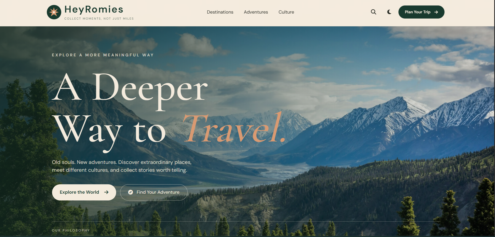
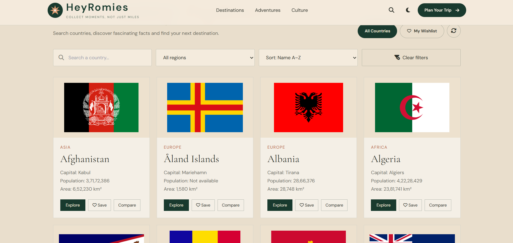
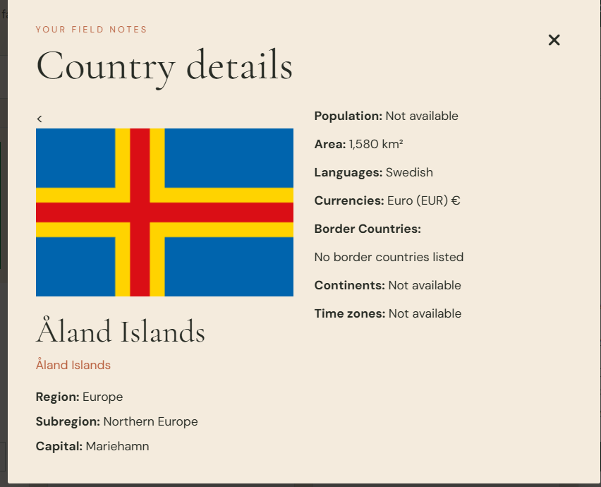

# HeyRomies 🌍

**Collect moments, not just miles.**

HeyRomies is a vintage-inspired World Explorer website that helps users discover countries, explore geographical information, search destinations, save favourites, and compare countries through a responsive and interactive interface.

## 🌐 Live Demo

[Visit HeyRomies](https://heyromies-nm4nkw21w-ishh2907.vercel.app/)

## 📂 GitHub Repository

[HeyRomies – GitHub](https://github.com/Ishh2907/HeyRomies)

## ✨ Features

- **Country Explorer:** Browse country information from around the world.
- **Country Search:** Search countries by name, capital, region, and subregion.
- **Debounced Search:** Updates search results after the user pauses typing.
- **Region Filter:** Filter countries according to geographical regions.
- **Sorting:** Sort countries by name, population, and area.
- **Country Details:** View capital, population, area, languages, currencies, continents, time zones, and border countries.
- **Favourites:** Save and manage favourite countries.
- **Country Comparison:** Compare up to three countries.
- **Dark/Light Mode:** Switch between two visual themes.
- **Explore More:** Load additional country cards progressively.
- **Skeleton Loaders:** Display placeholder cards while country data is loading.
- **Local Storage:** Preserve favourites, comparison selections, and theme preferences.
- **Responsive Design:** Works across desktop, tablet, and mobile devices.
- **Loading and Error Handling:** Includes loading, error, empty, and retry states.

## 🛠️ Technologies Used

- HTML5
- Tailwind CSS
- Vanilla JavaScript (ES Modules)
- Git and GitHub
- Vercel
- Font Awesome
- Google Fonts
- Browser Local Storage
- External REST APIs

## 📁 Project Structure

```text
HeyRomies/
│
├── index.html
├── README.md
│
├── images/
│   └── Project images
│
├── screenshots/
│   ├── home.png
│   ├── explore.png
│   └── country-details.png
│
└── js/
    ├── api.js
    ├── app.js
    ├── format.js
    ├── storage.js
    └── ui.js
```

## 🚀 Getting Started

### 1. Clone the Repository

```bash
git clone https://github.com/Ishh2907/HeyRomies.git
```

### 2. Open the Project

```bash
cd HeyRomies
```

Open the project folder in Visual Studio Code.

### 3. Run the Website

1. Install the Live Server extension in VS Code.
2. Open `index.html`.
3. Right-click and select **Open with Live Server**.

An active internet connection is required for external APIs, fonts, CDN resources, and images.

## 🌍 APIs Used

### 1. Mledoze Countries Dataset

Provides country information such as names, flags, capitals, geographical details, languages, currencies, and borders.

API: [Mledoze Countries Dataset](https://raw.githubusercontent.com/mledoze/countries/master/countries.json)

### 2. CountriesNow Population API

Provides population data for countries.

API: [CountriesNow Population API](https://countriesnow.space/api/v0.1/countries/population)

## 💾 Data Storage

HeyRomies uses the browser's Local Storage to save:

- Favourite countries
- Selected countries for comparison
- Theme preference

The saved data remains in the user's browser and is not automatically synced across devices.

## 📸 Screenshots

### Home Page



### Explore Countries



### Country Details



## 🎨 Design Concept

HeyRomies follows a vintage editorial travel aesthetic with warm paper-inspired backgrounds, earthy green accents, terracotta details, and elegant typography.

**Brand Line:** Collect moments, not just miles.

---

Made for curious explorers and people who believe every country has a story to tell. 🌍